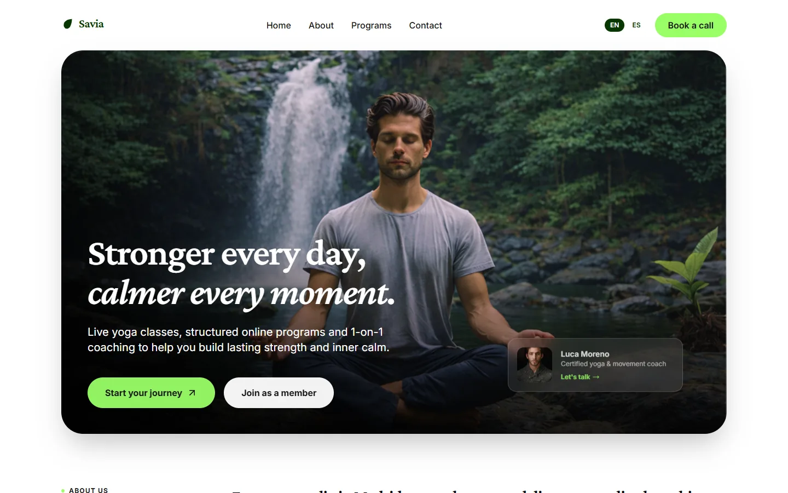

# Savia

A bilingual landing page for an online yoga studio in Madrid, rebuilt on top of the owner's v0-generated single-page design and finished to production quality.



## What it is

Savia is a one-page marketing site for an online yoga studio: hero, program explorer, results, testimonials, coach roster, pricing, contact and footer, in English and Spanish.

It is a demo, not a booking platform. The contact form is client-side only and does not submit anywhere; there is no backend, payments, authentication or persistence.

## Why this over a template

- **A finished page, not a starting point.** The v0 draft was rebranded to Savia, its filler copy, placeholder names and borrowed brand logos were replaced, and its sections were made consistent: one palette, one type scale, one pricing model.
- **Bilingual by default.** `/[locale]` routes, typed dictionaries, automatic browser-language detection, a manual switcher and `hreflang` alternates.
- **Typed translations.** `i18n/dictionaries/en.ts` defines the `Dictionary` type, so a missing or misspelled key in Spanish fails `pnpm typecheck` instead of rendering a blank label.
- **Euro pricing for the Spanish market.** Programs and plans are priced in euros from a single currency symbol in the dictionaries.
- **No remote media.** Every photograph and font is self-hosted under `public/`, so the page makes no third-party image or font requests.
- **Accessibility pass.** Skip link, labelled sections, `alt` text on every image, `aria-label`s on icon-only controls and visible keyboard focus.
- **SEO built in.** Canonical and `hreflang` links, JSON-LD (`Organization` + `ExerciseGym`), a sitemap, `robots.txt` and a per-locale Open Graph image.

## Quick start

Requirements: Node.js 24 (see `.nvmrc`) and pnpm 11.

```bash
git clone https://github.com/JORDANROBERTO74/savia-yoga.git
cd savia-yoga
pnpm install
pnpm dev
```

Open <http://localhost:3000>. The proxy redirects to `/en` or `/es` based on your browser's `Accept-Language` and remembers an explicit choice in a cookie.

| Command | What it does |
| --- | --- |
| `pnpm dev` | Start the development server on port 3000 |
| `pnpm build` | Create an optimized production build |
| `pnpm start` | Serve the production build |
| `pnpm typecheck` | Run `tsc --noEmit` |

## Internationalization

Copy lives in `i18n/dictionaries/en.ts` and `es.ts`. The English file defines the `Dictionary` type, so the Spanish file must implement the same shape and a missing key breaks the build instead of shipping a blank label.

- `i18n/config.ts` lists the supported locales and the default (`en`).
- `proxy.ts` detects the locale and redirects `/` to `/{locale}`.
- `components/locale-switcher.tsx` switches locale while preserving the current route and stores the choice in a cookie.
- `lib/seo.ts` declares canonical and `hreflang` alternates from `config/site.ts`.

## Region and currency

The studio is in Madrid, Spain, and all prices are in euros.

- `config/site.ts` holds the legal name, address, email, phone and social links.
- The currency symbol lives once in `common.currency` in the dictionaries (`€`).
- Program and plan prices are plain numbers in the dictionaries (`99`, `49`, `149`); the components render `€` plus the number, so changing a price is a one-line edit.

## Project structure

```text
app/
  [locale]/              localized route: layout, page and Open Graph image
  robots.ts              robots.txt
  sitemap.ts             sitemap.xml with hreflang alternates
  globals.css            Tailwind entry and base styles
  fonts.css              self-hosted font faces
components/
  sections/              header, features, why-us, testimonials, team, pricing, contact, footer
  logo.tsx               brand mark and wordmark
  locale-switcher.tsx    EN / ES switch
  json-ld.tsx            structured-data helper
  ui/                    shadcn primitives
config/
  site.ts               brand identity, contact details and social links
i18n/
  config.ts             locales, default locale and cookie name
  get-dictionary.ts     typed dictionary loader
  dictionaries/         en.ts (source of truth) and es.ts
lib/
  seo.ts                canonical, hreflang and Open Graph metadata
  utils.ts              class-name helper
public/
  images/               self-hosted photography
  fonts/                self-hosted Crimson Pro, Inter and DM families
docs/
  screenshot.webp
```

## Deployment

The app uses the default Vercel Next.js preset; no `vercel.json` is required.

1. Import the repository and keep the detected settings (`pnpm install`, `pnpm build`, output `.next`).
2. Set `NEXT_PUBLIC_SITE_URL` to the production origin.
3. Deploy, then verify `/{en,es}`, `/sitemap.xml`, `/robots.txt` and the Open Graph image.

`NEXT_PUBLIC_SITE_URL` drives canonical links, `hreflang`, `sitemap.xml`, `robots.txt` and Open Graph URLs. When it is unset, the code falls back to `https://savia-yoga.vercel.app`; the public demo sets it to its Vercel origin.

Live demo: <https://savia-yoga.vercel.app>

## Status and scope

This is a portfolio reference implementation, not a production booking platform. There is no backend, database, authentication or payment integration, and the contact form is intentionally non-functional.

Verification covers `pnpm typecheck`, `pnpm build`, and a manual pass in both locales at desktop and mobile widths: locale detection and switching, every section anchor, the program tabs, the testimonial hover states, the coach carousel, pricing cards and focus styles.

## License

Proprietary, all rights reserved. See [LICENSE](LICENSE). Third-party dependencies remain under their own licenses.
